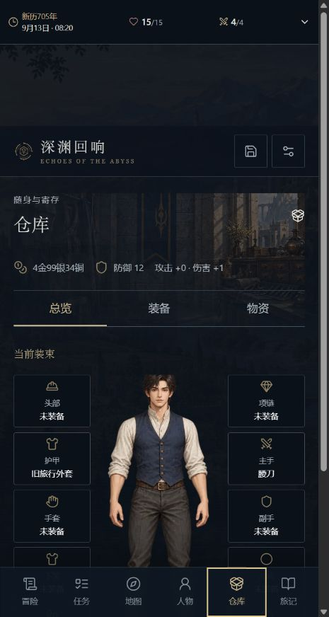

# 深渊回响

在蒸汽与诸界交会的世界里，从一个陌生清晨开始自己的生活。

[进入官网](https://slg-king.com/echoes/site/) · [浏览器游玩](https://slg-king.com/echoes/) · [下载 Android 3.1.0](https://github.com/JXZ666/echoes-of-the-abyss/releases/download/v2.2.0/echoes-of-the-abyss-2.2.0.apk) · [反馈问题](https://github.com/JXZ666/echoes-of-the-abyss/issues)

## 你会怎样生活

你可以先在旅店安顿，靠普通技艺谋生，再决定追查城里的异状，或沿商路去更远的地方。人物有自己的日程和打算；错过的约定、留下的人情和做过的坏事都会影响后来的相遇。

- 选择种族、出身与属性，探索职业和力量；装备各有用途，特殊物品也有代价。

- 用调查、交涉、准备、同伴或战斗处理事件。D20 检定由本地规则结算，结果会保存。

- 传统模式可以离线游玩；高 AI 模式可选接入自己的服务商，在同一套规则下扩展叙事与局部内容。

- 在任务、人物、仓库、地图和旅记之间查阅已知信息，保存自己愿意留下的一段人生。

## 界面

## 开始游玩

1. 网页直接进入，或从 Releases 下载 APK。Android 要求 7.0 或以上。

2. 开启新人生；未游玩过时，从凡人身份认识世界。

3. AI 并非必需。使用时在设置填写自己的服务商 Key，并测试连接。

2.2.0 扩展两国聚落与公会限时勘探活动，补充当地人物、跨地点工作和回访变化。成长内容开放至五阶，重整材料来源与能力用途；补齐预设地点简图，继续区分人物话语与旁白动作。旧人物、已得权益和十槽名称继续保留。

Android 安装包沿用原证书，支持覆盖升级。升级前建议导出本地存档备份；支持的旧档可转换后续玩，原文件保留。

## 存档与隐私

网页和 APK 使用本机存档，不会自动联网互通。设置中导出迁移包，再在另一端导入，可以继承角色、世界进度与已解锁开局资格。导入前建议另存当前进度；旧版人物档按支持的格式转换，原文件不会被覆盖。

迁移包不含 API Key。网页 Key 只留在当前会话；Android 使用系统密钥保护。调用 AI 会把当前行动所需的上下文发送给你选定的服务商；可随时关闭 AI。游戏没有账户、云存档和后台离线推进。

游戏面向成年人。关系内容可关闭；当前内置内容采用成年、自愿、非露骨的关系剧情，关闭后仍能完成必要故事。

## 更新与反馈

[2.2.0 更新说明](CHANGELOG.md) · [发行说明](DISTRIBUTION.md) · [第三方许可](NOTICE.md)

QQ 交流群：**1124074040**。欢迎交流玩法、提交问题和反馈。报告问题时注明版本、设备或浏览器、复现步骤；不要上传 API Key 或包含私人内容的完整存档。

同作者项目：[黄油之王](https://slg-king.com/)。

本次未进行真实 AI 服务商联调和手机真机验收；浏览器检查与规则测试不能代表所有设备的表现。

本仓库用于游戏发行与反馈，不包含游戏源码或官方攻略。

## 1.8.0 · 镜海初航

办理文书，乘联运客船前往异国港城。核货、护送、勘路和搜寻需要实际到场、工作与交接；公会资格、谋生主业和个人成长分别记录。新增原创场景与人物画，旧档转换后保留原文件。

## 1.7.0 · 行旅与日常

通用技艺学会即可使用，不设熟练度，强度低于超凡能力。营生试行提供有限往返合约和实际交接；阅读与行动保持稳定空间，旧档转换后保留原文件。

## 1.6.0 · 把话说清，行路从容

对白内续问、常驻手牌托盘和场景简图减少来回查找；任务与人物资料更清楚。行动分类默认收起，展开与收起保留阅读位置，手机优先阅读，平板按空间布局。

